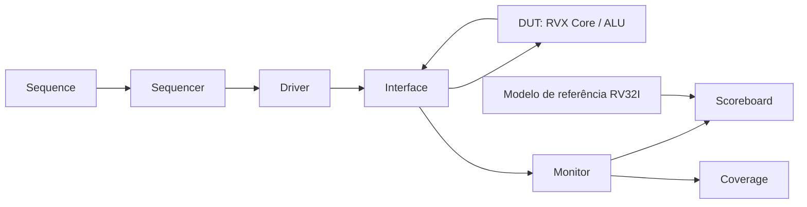

# Diagrama do Ambiente de Verificação UVM da ALU do RVX

## 1. Objetivo

Representar a arquitetura inicial do ambiente UVM que será utilizado para verificar as operações da ALU do processador RVX conforme a especificação RV32I.

## 2. Diagrama

## 3. Componentes

- **Sequence:** cria os casos de teste das operações da ALU.
- **Sequencer:** organiza e envia as transações para o Driver.
- **Driver:** transforma as transações em estímulos para o DUT.
- **Interface:** conecta o ambiente UVM aos sinais do RVX.
- **DUT:** implementação da ALU existente no arquivo `rtl/rvx_core.v`.
- **Monitor:** observa entradas e resultados sem alterar o funcionamento do DUT.
- **Scoreboard:** compara o resultado produzido pela ALU com o resultado esperado.
- **Coverage:** registra quais operações, operandos e casos de borda foram exercitados.
- **Modelo de referência RV32I:** calcula o resultado esperado de cada operação conforme a ISA.

## 4. Fluxo da verificação

1. A Sequence cria uma operação e seus operandos.
2. O Sequencer entrega a transação ao Driver.
3. O Driver aplica os estímulos ao RVX por meio da Interface.
4. O Monitor coleta a operação executada e o resultado produzido.
5. O Scoreboard compara o resultado real com o resultado esperado.
6. O componente de Coverage registra os cenários exercitados.

## 5. Comunicação

A comunicação entre o Monitor, o Scoreboard e o componente de Coverage será realizada por portas de análise do TLM 1.0. A conexão entre o Driver e o Sequencer utilizará o mecanismo padrão de sequência do UVM.

## 6. Escopo inicial

O ambiente será desenvolvido inicialmente para a ALU e para as operações RV32I identificadas no Test Plan. Posteriormente, a estrutura poderá ser ampliada para outras partes do RVX e para os experimentos de injeção de falhas.